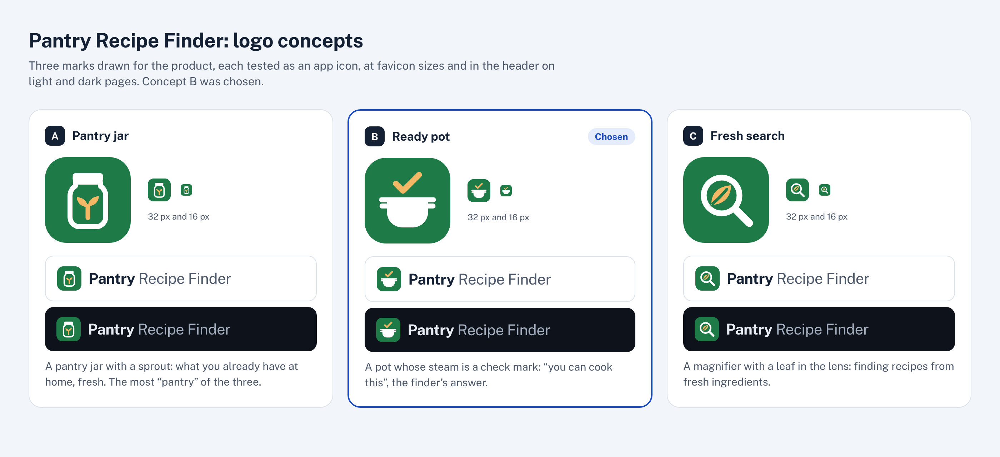

# Logo

A pot whose steam is a check mark: “you can cook this”, the finder’s answer.

| Part | Color |
|---|---|
| Tile | `#1E7A46` (`--good-fill`) |
| Pot | `#FFFFFF` |
| Check | `#F2B866` |

Token names refer to `src/styles/tokens.css`.

## Using it

- The tile keeps its colors on light and dark pages. On dark pages the site adds a 1px edge (`--line-strong`) so the tile does not blend into the background.
- It stays legible down to 16px, the favicon size.
- Next to the mark, the name is set in Public Sans: **Pantry** in bold (700), then Recipe Finder in regular (400) and the muted text color (`--muted`).
- The mark lives in four places that change together: `markSvg()` in `src/components/ui/icons.ts`, `public/favicon.svg`, `scripts/og/og.html` (the source of the share image and the touch icon) and `logo.svg` here.

## How it was chosen

Three concepts were drawn and tested as an app icon, at 32px and 16px, and in the header on light and dark pages. Concept B was chosen. Each one is also an SVG here: `concept-A.svg`, `concept-B.svg` and `concept-C.svg`.

